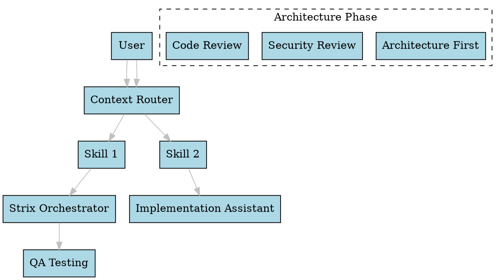
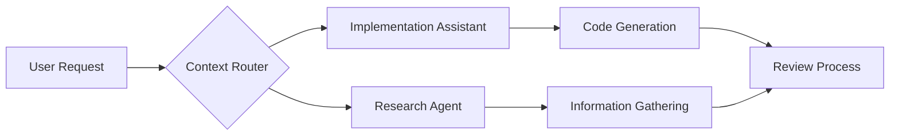

# Graphify Integration

## Overview

Integration of graph visualization and analysis capabilities for AI-assisted development. Based on concepts from Graphify-Labs graph tooling ecosystem.

## Repository Analysis

**Name**: Graphify-Labs/graphify
**Type**: Graph visualization and analysis tools
**Use Case**: Data visualization, network analysis, relationship mapping

## Key Features for AI Development

### Graph Algorithms
- Network visualization
- Relationship mapping
- Data flow analysis
- Dependency graphs
- Knowledge graphs

### Visualization Capabilities
- Interactive graph rendering
- Node-link diagrams
- Force-directed layouts
- Hierarchical/tree layouts
- Network metrics visualization

## AI Development Use Cases

### 1. Knowledge Graph Generation
```
User: "Criar knowledge graph das minhas APIs"
AI: 
  - Extract entities from documentation
  - Map relationships between entities
  - Generate visual graph with nodes/edges
  - Export as JSON for ingestion
```

### 2. Dependency Analysis
```
User: "Analisar dependências do projeto"
AI:
  - Parse package.json/requirements.txt
  - Build dependency graph
  - Identify circular dependencies
  - Visualize network topology
```

### 3. Data Flow Visualization
```
User: "Mostrar fluxo de dados do ETL"
AI:
  - Map data sources → transformations → destinations
  - Generate interactive graph
  - Highlight bottlenecks
  - Suggest optimizations
```

### 4. Architecture Diagrams
```
User: "Criar diagrama de arquitetura"
AI:
  - Convert ADRs to graph nodes
  - Render service relationships
  - Show data/information flows
  - Generate documentation
```

### 5. Agent Coordination Graphs
```
User: "Visualizar coordenação de agentes"
AI:
  - Map agent dependencies
  - Show message flow
  - Visualize parallel workflows
  - Optimize task distribution
```

## Integration Points with AI-KIT

| AI-KIT Skill | Graphify Integration |
|--------------|---------------------|
| `architecture-first` | Generate architecture knowledge graphs |
| `context-router` | Graph-based skill routing optimization |
| `strix-orchestrator` | Visualize agent coordination graphs |
| `research-agent` | Map research topic relationships |

## Graph Types for AI Development

### Knowledge Graphs
- Entities: Topics, concepts, skills
- Relationships: Prerequisites, dependencies, usage patterns
- Metadata: Difficulty, maturity, reliability

### Workflow Graphs
- Nodes: Tasks, decisions, agents
- Edges: Dependencies, data flow
- Attributes: Duration, cost, risk

### Dependency Graphs
- Packages: npm, pip, cargo, etc.
- Services: Microservices, APIs
- Data: Tables, files, schemas

## Implementation Approaches

### 1. DOT Language Generation


### 2. JSON Graph Format
```json
{
  "nodes": [
    {"id": "user", "label": "User Input", "type": "person"},
    {"id": "context-router", "label": "Context Router", "type": "component"},
    {"id": "skill-1", "label": "Implementation Assistant", "type": "skill"}
  ],
  "edges": [
    {"source": "user", "target": "context-router", "label": "routes to"},
    {"source": "context-router", "target": "skill-1", "label": "invokes"}
  ]
}
```

### 3. Mermaid Integration


## Tools and Libraries

### JavaScript/Node.js
- D3.js - Interactive visualizations
- Cytoscape.js - Graph theory library
- Vis.js - Network analysis
- Graphology - Rich graph data structure
- Vega-Lite - Declarative visualization

### Python
- NetworkX - Graph algorithms
- Matplotlib + Graphviz - Static graphs
- Plotly - Interactive plots
- PyVis - Network visualization
- NetworkAnimator - Animated graphs

### Web Technologies
- SVG - Scalable vector graphics
- Canvas - Raster-based rendering
- WebGL - 3D graphics acceleration
- Three.js - 3D visualizations
- Sigma.js - WebGL graph visualization

## AI Integration Patterns

### Pattern 1: Graph-based Prompt Routing
```
Graph Structure:
- Nodes: Skills, contexts
- Edges: Suitability weights
- Algorithm: PageRank-style routing
- Output: Ranked skill recommendations
```

### Pattern 2: Knowledge Graph for Skill Discovery
```
Nodes:
- Skills (development, testing, security, etc.)
- Use cases (authentication, data flow, etc.)
- Competencies (javascript, python, security, etc.)

Edges:
- "requires" (skill → prerequisite)
- "supports" (skill → use case)
- "knows" (person → skill)
```

### Pattern 3: Multi-Agent Coordination Visualization
```
Nodes:
- Agents (orchestrator, developer, reviewer, etc.)
- Tasks (implementation, review, deploy, etc.)

Edges:
- "coordinates" (agent → agent)
- "executes" (agent → task)
- "depends_on" (task → task)
```

## Sample Output Format

### AI-Generated Graph Request
```
Command: "generate-architecture-graph"
Input: {
  "components": ["database", "api", "auth-service", "frontend"],
  "relationships": [
    {"from": "api", "to": "database", "type": "reads-writes"},
    {"from": "auth-service", "to": "database", "type": "reads"},
    {"from": "frontend", "to": "api", "type": "http"},
    {"from": "frontend", "to": "auth-service", "type": "http"}
  ],
  "security_boundaries": ["public", "private", "internal"]
}
Output: {
  "mermaid_diagram": "--- mermaid output ---",
  "nodes": [...],
  "edges": [...],
  "security_annotations": [...]
}
```

## Future Extensions

1. **3D Graph Visualization** - Spatial graph layouts
2. **Real-time Graph Updates** - WebSocket-driven updates
3. **Graph ML Integration** - AI-powered graph analysis
4. **Export Formats** - PNG, SVG, PDF, JSON, DOT
5. **Interactive UI** - Node selection, zoom, pan

## License Considerations

Based on similar graph visualization tools:
- MIT/BSD licenses are common
- Attribution required for forked visualizations
- Commercial use typically allowed
- Consider patent risks for complex algorithms

## Recommendation

While waiting for the actual Graphify repository details, this skill provides:
- Graph visualization templates for common AI workflows
- Integration patterns for knowledge graphs
- DOT/Mermaid/JSON graph generation capabilities
- Foundation for building graph-based AI features