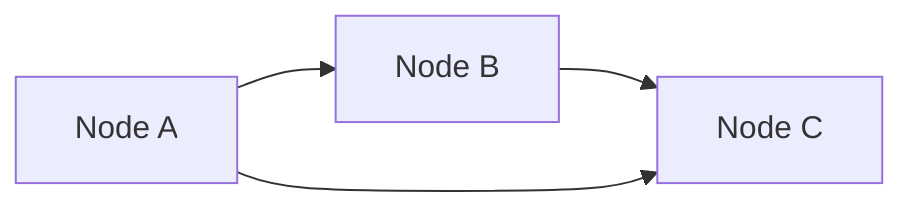
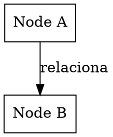

# GRAPH VISUALIZATION

Visualização e análise de grafos para AI development.

## QUANDO USAR

- Visualizar arquiteturas de sistemas
- Mapear dependências entre componentes
- Criar knowledge graphs de habilidades
- Analisar fluxos de dados e tarefas
- Gerar diagramas de relacionamento
- Visualizar grafos de agentes multi-agente

## TIPOS DE GRAFO

### 1. Architecture Graph
- Nós: Serviços, bancos de dados, APIs
- Arestas: Comunicação, dependêncicias, dados
- Uso: Documentação, revisão, onboarding

### 2. Dependencies Graph
- Nós: Pacotes, módulos, bibliotecas
- Arestas: Dependências, importações
- Uso: Análise de risco, atualização de dependências

### 3. Workflow Graph
- Nós: Tarefas, agentes, decisões
- Arestas: Fluxo de execução, dependências
- Uso: Orquestração, otimização de processos

### 4. Knowledge Graph
- Nós: Conceitos, habilidades, tópicos
- Arestas: Prerequisites, relacionamentos, uso
- Uso: Recomendação de aprendizado, roteamento de skills

### 5. Agent Coordination Graph
- Nós: Agentes, tarefas, recursos
- Arestas: Mensagens, coordenação
- Uso: Visualização de multi-agente

## FORMATOS DE SAÍDA

### Mermaid


### DOT (Graphviz)


### JSON Graph
```json
{
  "nodes": [{"id": "A", "label": "Node A"}],
  "edges": [{"source": "A", "target": "B", "label": "relaciona"}]
}
```

## EXEMPLOS DE USO

### Knowledge Graph de Skills
```
Input:
{
  "graph_type": "knowledge",
  "output_format": "mermaid",
  "nodes": [
    "security-audit", "code-review", "architecture", 
    "implementation", "qa-testing", "deployment"
  ],
  "edges": [
    {"from": "architecture", "to": "code-review", "type": "requires"},
    {"from": "security-audit", "to": "implementation", "type": "requires"},
    {"from": "implementation", "to": "qa-testing", "type": "requires"}
  ]
}

Output: Mermaid diagram showing skill dependencies
```

### Arquitetura de Sistema
```
Input:
{
  "graph_type": "architecture",
  "output_format": "mermaid",
  "include_security": true
}

Output: Diagram showing services, data flows, security boundaries
```

### Coordonação de Agentes
```
Input:
{
  "graph_type": "agent",
  "output_format": "mermaid",
  "nodes": ["User", "Context-Router", "Implementation-Assistant", "QA-Tester"]
}

Output: Flow chart of agent interactions
```

## INTEGRAÇÃO COM AI-KIT

| Skill | Uso |
|-------|-----|
| architecture-first | Gerar diagrams de arquitetura |
| context-router | Visualizar routing de skills |
| stix-orchestrator | Mostrar coordenação de agentes |
| skill-library | Criar knowledge graphs de habilidades |
| snippet-library | Mapear relacionamentos entre snippets |

## RECURSOS ADICIONAIS

- [Mermaid Docs](https://mermaid.js.org/) - Sintaxe e exemplos
- [Graphviz](https://graphviz.org/) - Ferramenta de layout
- [D3.js](https://d3js.org/) - Visualização web interativa
- [NetworkX](https://networkx.org/) - Python graph algorithms

## LIMITAÇÕES

```
⚠️ Diagramas são estáticos sem interação
⚠️ Grafos complexos podem precisar de layout específico
⚠️ Visualização web requer integração adicional
```

## SAÍDA ESPERADA

Objeto com:
- Código do diagrama (Mermaid/DOT)
- Estrutura de nós e arestas
- JSON exportável
- Instruções de renderização